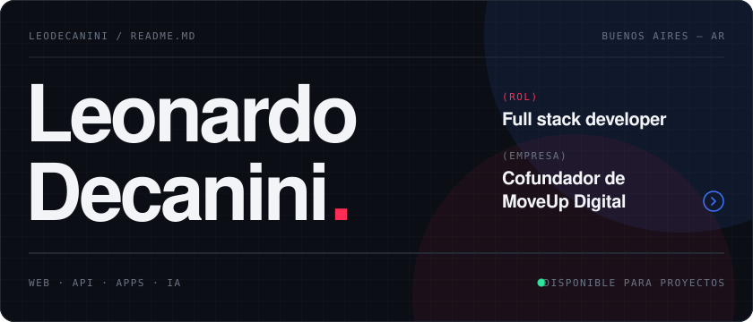
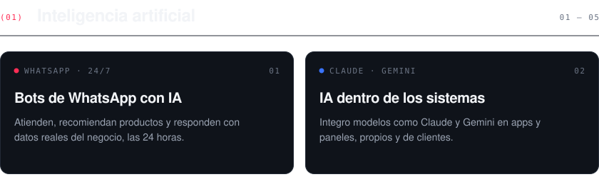
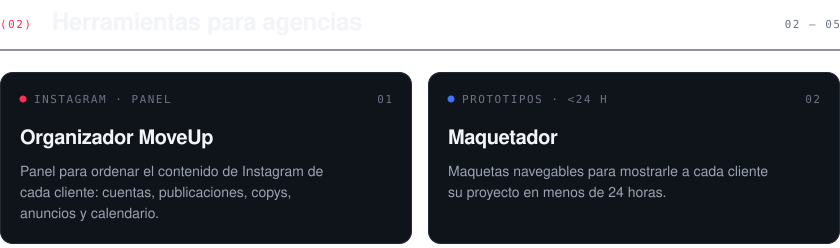
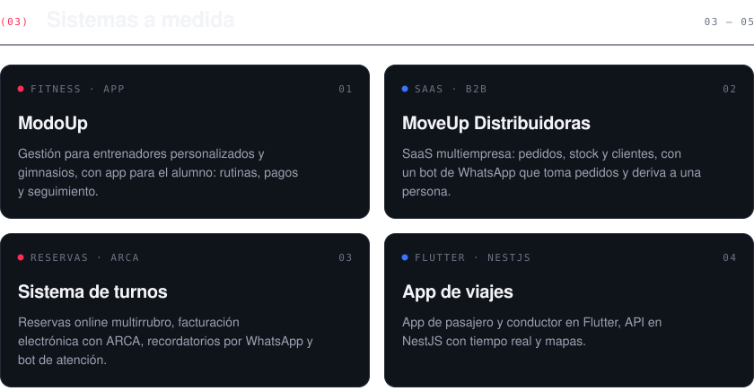
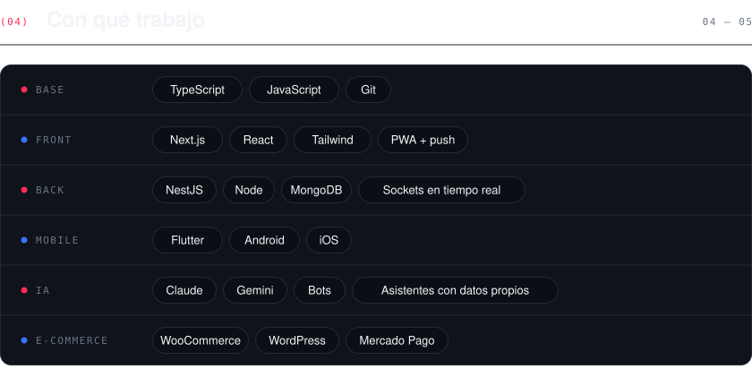
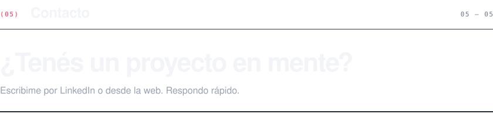

 

Construyo sistemas a medida, soluciones con IA y herramientas para agencias. En [MoveUp Digital](https://moveup.digital) desarrollo productos de punta a punta: la web, el panel de administración, la API y la app del celular.

 

  

  

  

  

  
  
  

